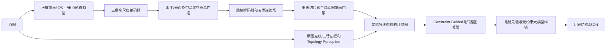

# DirectionalFieldNet：从候选边打分转向连续场感知

2026-10-04。本轮完成新架构实现、三组 GPU 训练、新数据接入、图像推理集成和实测。它是 GraphSchematic 的可选视觉分支；默认不启用。正式比赛技术报告继续暂缓。

## 新角度与架构

上一轮 GEA-Net 从已经提取的候选关联边中选择连接，无法恢复前端漏掉的导线。本轮直接学习连续空间中的水平导线、垂直导线、引脚端点、弱交汇点、笔画五类场，让特征编码先区分长直导线与元件/文字笔画，再交给几何图和电气超图推理。当前运行时只有导线场用于可选掩膜筛选；端点和交汇场保留为诊断，尚不替代原有引脚编号或电气连接判定。



输入是 3×192×192 的灰度笔画及水平/垂直形态特征，不输入 GT、网络 ID 或 RGB 类别规则。编码通道 16/32/64，残差块用局部 3×3、水平 1×15、垂直 15×1 深度卷积和软门控；多尺度跳接解码输出五张热图。全图通过步长 96 的重叠切片和 Hann 加权融合恢复，最多 1600 个切片，超出或模型输出异常时回退本地几何掩膜。

设计参考 [Strip Pooling 原论文](https://arxiv.org/abs/2003.13328) 的方向性长程上下文思想；本项目采用深度卷积，未复现其池化算子，也未声称学术首创。损失包括类别加权 BCE、Dice 和有限次可微骨架连续性项，受 [clDice 原论文](https://arxiv.org/abs/2003.07311) 启发；该辅助项不能保证电气拓扑正确。

## 实际训练数据

| 来源 | 训练/验证裁剪 | 划分与监督 |
| --- | --- | --- |
| PCBnet | 1446 / 330 | 241 / 55 页；去重并排除 0237；原向量导线、标注引脚、弱交汇点；笔画伪标签 |
| 自建程序绘图 | 408 / 104 | 102 / 26 个布局族；同族风格不跨划分；共 512 个裁剪，不能计作 512 个独立电路设计 |
| CGHD v16 子集 | 516 / 124 | 129 / 31 张原图，按 drafter 留出；只监督笔画，不监督导线/连接 |

CGHD 下载 160 组，覆盖 33 个 drafter；验证与训练存在 C1、C2 设计前缀重复，属于留出书写者的风格验证。新增 AMSNet 实际 734 个独立原图案例，尚未用于训练。更多来源、授权差异、不可获取数据和哈希核查见 [数据来源记录](NEW_DATA_SOURCES.md)。官方 10GT 不用于训练。

三组都训练 6 个 epoch、相同随机种子 20261005、AdamW、初始学习率 0.001、batch 16。验证集选最佳 checkpoint 和导线门限 0.7，因此下面是开发验证指标，不是独立测试成绩。

| 训练组 | 参数 | 最佳 epoch | PCB 水平/垂直像素 F1 均值 |
| --- | ---: | ---: | ---: |
| 条带架构，PCBnet+自建 | 72948 | 6 | 0.695596 |
| 条带架构，增加 CGHD | 72948 | 6 | 0.698411 |
| 局部卷积对照，同样三来源 | 69108 | 5 | 0.677444 |

条带方向上下文在本次单种子实验中优于局部卷积约 0.02097。参数量不同，尚未做等参数、多种子实验，不能断言差异全部来自结构创新。增加 CGHD 同时增加训练 batch 数，尚未控制总优化步数，0.00282 的像素收益也不足以证明数据效应稳定。

基准组水平/垂直像素 F1 为 0.73457 / 0.65660；相同裁剪的 7 像素形态开运算为 0.37137 / 0.25643。该比较只针对方向掩膜，不是整个旧解析系统的精度。基准组引脚热图 5 像素匹配 F1 在门限 0.7 时为 0.51783；弱交汇热图表现很差（门限 0.3 时 F1 0.04811），所以两者未接管比赛结果。完整三组的像素、关键点和 ONNX 数值核查见 `output/field-verification/`。

导出核查允许 logits 最大绝对差 0.001、sigmoid 概率差 0.0001，用于容纳 GroupNorm 的 CPU 归约顺序差异。基准组概率最大差约 0.00007695，三来源条带组约 0.00009590；即便关闭 ONNX 图优化，三来源 logits 差仍约 0.00052。记录这些数值，不宣称逐位一致，也不能据此保证所有门限附近像素分类一致。

## 整图实测与默认决策

实际 PNG 推理完毕后才读 GT。相同默认主/辅引脚、OCR、检测器和电气图规则，运行最新公开 10GT；以下是本地 Q&A 代理评估，尚未核验与官方脚本等价。

| 流程 | 元件 F1 | 引脚 F1 | 网络超图 F1 | 导线 F1 | 加权代理分 |
| --- | ---: | ---: | ---: | ---: | ---: |
| 当前默认引脚共识 | 0.378862 | 0.128491 | 0.081985 | 0.100563 | 18.453222 |
| 加入条带模型，未用 CGHD | 0.378862 | 0.128491 | 0.080004 | 0.113495 | 18.513234 |
| 加入条带模型，使用 CGHD | 0.378862 | 0.128491 | 0.080004 | 0.098072 | 18.359003 |

新方向场提高了局部导线掩膜质量，但筛除部分笔画也会断开本来有效的导线、改变关联支撑。CGHD 的手绘分布及笔画任务并不等同于 PCB 导线语义。元件与引脚编号的主要错误没有被这个分支解决。当前不把它替换为默认模型，也没有声称提高 55 页整图成绩；本轮没有重跑该 55 页整图集。下一步应针对真实 PCB 断线/交叉线建立更准确监督，并尝试把连续场置信度作为关联证据，而不是硬删导线。

Topology > Geometry > Color 继续生效：高概率不能在白底造线；三臂/点状连接证据读取原始灰度笔画，分割漏一臂不能制造 T 型连接；原有 Topology Perception 决定电气接触。Geometry-to-Electrical 双图、全局关联、电路先验、同名标签飞线合并及大模型候选白名单仍保留。大模型图回放也传递相同可选场模型，避免纠错过程采用不同图像证据。

## 运行和交付

```powershell
.venv/Scripts/python.exe -m pcbparse infer data/examples/guide-schematic.png --field-model models/candidates/directional-fields/field.onnx --output output/field-example.json --diagnostics output/field-example-diagnostics.json --graph-output output/field-example-graph.json
.venv/Scripts/python.exe scripts/benchmark_official.py --pin-ensemble auto --field-model models/candidates/directional-fields/field.onnx --output output/benchmark-official-fields
.venv/Scripts/python.exe -m unittest discover -s tests
```

`--field-model auto` 默认读取配置，本轮配置为 none；指定候选 ONNX 才启用。推理仍不需要 PyTorch。64 项功能测试已通过，新测试覆盖整图边缘切片、白底门限、交叉线保护与错误维度。

开发包包含实现、三组候选 ONNX/元数据、消融摘要、数值核查与数据归属记录；不含原始训练图像。仍有官方评分脚本、Docker 构建、比赛环境验收和整体精度提升待完成，当前属于开发候选。
