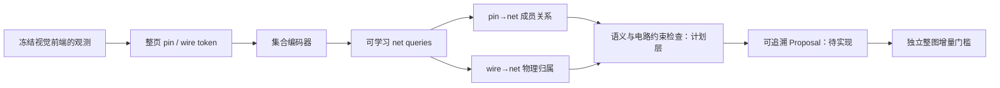

# 新方案：NetSetQuery——以整页网络集合为中心的原理图解析

2026-10-06。用户明确要求“继续从另一个角度重新构建方案”，据此重新开展隔离架构研发。此前暂停研发的选择被本次明确请求更新；RC0、人工审核与独立验证门禁没有解除。PPN/MST/Agreement旧分支仍归档，不重新训练、不调其阈值、不修改其结果。

## 视角变化

之前的学习任务是“这个局部交叉是否连接”，再把局部修改接入已有图。新方案把任务改成：给定整页已观测的pin、wire与语义证据，预测一组电气net，每个net包含哪些pin、拥有哪些物理线段。成员关系是直接输出，不是若干junction分类的间接副产物。

核心假设：如果训练、解码与晋级都面向网络集合，可能减少局部正确而系统无收益的目标错位。该假设尚未获得准确率证据。它仍需要可靠身份、坐标和网络标签，不能绕开人工验证。

借鉴[DETR](https://arxiv.org/abs/2005.12872)的集合输出/二分匹配思路，以及[Set Transformer](https://arxiv.org/abs/1810.00825)的集合建模思路；把输出实体改为电气超边不是已经证明的学术新颖性。本文描述本项目实现与后续验证假设。



## 已落地的原型

`experiments/netset_query.py` 实现189,186参数、128个net query、64维集合编码器与Transformer decoder。pin和wire各自有类型嵌入，没有输入序号位置编码。几何坐标保留为输入特征，因此输入集合的排列不改变网络成员预测的对应关系。

- **输入**：每个pin/wire为12维观测特征，包含归一化位置、局部框几何、接触数量或线段范围等；不输入GT net ID或GT成员关系。器件key/pin号只在单独metadata中用于输出对齐，不成为网络可记忆的字符串特征。
- **输出**：每个pin和wire的128个net-slot logits，外加一个abstain通道；128个net existence logits。pin的单一slot分配可表示一个全局分区。abstain是通道，尚未经过训练/校准，不能据此宣布具备可靠弃权。
- **训练损失原型**：对已知部分的GT pin-set与net query做Hungarian匹配，再计算成员交叉熵、soft-Dice和已观察net的存在性正监督。任意GT net名称重编号不改变损失。
- **unknown处理**：标签为−1时不进入监督损失，不能作为“不连接”或singleton。部分监督下未观察的net也不能标为不存在。因此目前存在性只做正监督，不能支持校准过的网络数量预测。

这是网络目标的可微替代损失，不等于官方NetHypergraphF1或官方assignment代价。官方评测器仍未取得。

## 数据入口与实际限制

新建 `data/processed/netset-query-prototype`，只读取现有65张开发页缓存，不重新推理原图，不碰Freeze-A，也不下载数据。先保存观测输入，再单独读取既有开发GT生成诊断性weak-targets；二者文件分离。

| 数据审计 | 数量 |
|---|---:|
| 已有开发页 | 65 |
| 输入预测pin | 2719 |
| 输入物理wire | 12022 |
| 弱标签兼容pin | 466 |
| unknown pin | 2253 |
| 已观察的部分net（逐页累加） | 363 |
| 单页最大已观察部分net | 48 |

兼容条件为：精确component/pin身份、类型一致、点距离≤5px、box pin名称一致、GT只有唯一net归属。不用最近点冒充真实身份。466/2719≈17.14%是严格筛选下的弱监督覆盖率，**不是pin识别准确率**，也不是人工认证；非box随机编号使该筛选比Q&A代理匹配更严格。最大48是已观察部分net数，不能当整页真实net总数或证明128个slot始终足够。

本轮没有使用这65页训练模型，也不会把它们包装成新独立集。当前上游可见身份/坐标与完整监督的缺口非常明显；只更换net decoder不可能自动恢复遗漏的pin或修正错误pin坐标。

## 实际执行的检查

现有CPU/Torch环境对PCB55/0140真实缓存运行前向与反向：128个pin、292条wire，其中77个pin通过弱标签兼容筛选。检查包含：

1. 随机打乱pin/wire顺序，对应的成员输出保持等变。
2. GT net标签任意重编号，loss完全相同。
3. 改变unknown pin的输出logits，不改变监督loss；全unknown页的loss为0。
4. 反向梯度有限。

详细数值在 `output/netset-query-prototype/architecture-check.json`。**optimizer steps=0，没有训练好的权重、识别成绩或整图增益。** 不把一次backward当成模型训练。

## 接下来应如何验证这个方案

先解决训练定义，不直接扩大模型：

1. **身份与监督分层**：将视觉pin候选、已确认身份和未知身份分开；训练应使用允许的训练设计，开发/盲测保持设计族分离。精确身份层与几何oracle层分别报告，不能混算。
2. **补完整网络/物理归属监督**：现有wire head只有输出接口，未加入wire ownership监督。需要可靠GT映射后单独训练；不能把墨迹、同色或相交关系直接当电气标签。
3. **加入可见文字与远距离飞线证据**：同名标签对应语义约束，只合并逻辑关系，不生成不存在的物理线段。目前metadata保留既有label关系，神经文字编码和约束解码尚未实现。
4. **解码与事务**：模型产物只作为Proposal；显式检查每pin至多一net、显式电源域冲突、物理线段来源、语义飞线和query容量。unknown保持未决；已有net的改变要以完整事务记录，不能拿局部概率自动Commit。
5. **系统准入**：同一前端、同一开发页、相同评估配置下比较原NetHypergraphF1/NetLineF1及逐页退化；取得正式评分器后再统一核验。局部loss下降和成员准确率只作诊断，不授予发布权限。

## 实现边界

当前已实现的是观测token入口、集合模型、部分网络损失及原型检查。尚未实现padding mask、多页批训练、可见文本编码、语义约束解码、线段监督、query容量自适应、概率校准和正式Proposal导出。输入只包含已有视觉前端恢复的pin/wire；当前不承担新pin生成或缺失身份恢复。多页变长数据先按单页处理，超过query容量时明确报错，不能悄悄截断。

这是新研究方案的可运行起点，不是端到端比赛成品。RC0保持原状，真实Reviewer A/B仍未收到完成记录，verified designs仍0，official evaluator equivalence仍unresolved。

## 复现

```powershell
# 首次构建诊断输入；已有audit时拒绝覆盖
.venv/Scripts/python.exe scripts/prepare_netset_query_prototype.py

# 使用现有Torch环境进行原型检查，无优化器更新
$env:PYTHONPATH=(Resolve-Path .deps).Path
D:/Python313/python.exe scripts/check_netset_query_prototype.py
```
