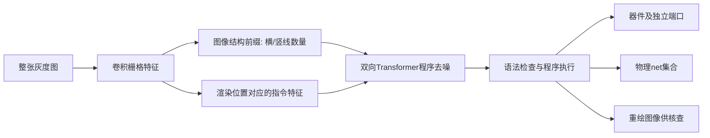

# CircuitProgramNet-H：整图 → 可执行电路程序

2026-10-07。按用户重新研发、重新训练和扩充数据要求开展。模型和数据均为隔离研究分支，旧RC0和人审协议不变。实际成绩另见训练结果报告。

## 从图逆推生成过程

之前PortLift依赖已观察wire图和端口附着。本轮只输入128×128灰度整图，预测绘图/连接指令，由解释器执行生成物理网络与器件端口。图像生成过程而非net query成为中间表示，避免把组件间“可以经过电阻的通路”误认为同一net。

程序不是自然语言或大模型生成文本。68个有限指令槽包括两项线数量、36项交点CROSS/JOIN、30项竖向间隔WIRE/R/C。无效位置必须ABSENT。横/竖线数量从图像条带特征单独预测；交点和器件指令从图像特征及部分程序上下文预测。电阻/电容指令**断开**其上下导线节点并建立两个独立端口，不把器件两端union。

解释器有严格类型/位置检查，输出net集合与R/C器件结构。渲染器可将程序重新绘图；本轮图像重绘用于诊断，不是已实现的可微渲染loss或真实CAD校准。

## 模型与程序生成

卷积24→48→96三次stride2形成16×16栅格；2D坐标编码；68个程序位置嵌入；两层双向Transformer Decoder、4 attention heads、FF192。指令锚点来自**固定渲染语法**，通过grid_sample读对应栅格特征和直接局部预测头。没有给模型逐图真值box、端点、wire图、端口归属或net标签作为输入。

但这不等于没有几何先验：128像素画布、最多6×6规则网格、固定指令坐标都是强先验。当前不处理任意位置的器件、多引脚IC、OCR、net label或跨页/飞线语义。R/C只放在竖向间隔；其值、名称和实际pin编号未建模。它是完整栅格图输入的受控程序重建原型，不是通用比赛解析器。

训练时50%批次全部指令MASK，其余批次独立遮蔽30%–100%指令；Loss是被遮蔽位置的加权CE。推理从全部MASK开始，六轮按置信度填充，语法仅使用预测的结构前缀。报告同时比较完全MASK的一次性预测，以检验迭代是否真正有益。

受[MaskGIT](https://openaccess.thecvf.com/content/CVPR2022/html/Chang_MaskGIT_Masked_Generative_Image_Transformer_CVPR_2022_paper.html)的遮蔽生成思想启发，输出换为有执行语义的电路指令。当前是离散mask去噪，不声称严格扩散模型，也未证明学术首创。

## 四份预登记实验与诊断

| 实验 | 修改 | tiny结论 / 主训练状态 |
| --- | --- | --- |
| V1 | 全局程序注意力；tiny只见全MASK | 一次性4页全正确，六轮生成最终失败；按原门槛未进入主训练 |
| V2 | 加部分程序遮蔽；LogicBench扩充图像预训练 | tiny最终3/4程序正确，未进入主训练 |
| V3 | 加渲染位置特征 | tiny350步4/4正确，但400步结构数量退化；原final门槛失败，未进入主训练 |
| V4 / H | 数量前缀只读图像；tiny余弦衰减及事前best检查点规则 | tiny350/400步均4/4正确，正式进入8192整图训练 |

V4规则改为事前登记检查点中存在完整可拟合结果；tiny本来就是训练诊断，不是独立分数。此次V4最终400步也通过，完整保留V1–V3失败日志，不将其改写为通过。V4只继承本次V2**图像预训练**encoder/projection，程序解码器、前缀和位置头重新随机初始化；没有继承tiny程序训练权重。

## 真正进入训练的数据

| 来源 | 有效来源图像 | 图像预训练裁剪 | 电气标签使用 |
| --- | --- | --- | --- |
| 既有PCBnet train | 237 | 3780 | 本分支不用 |
| 既有AITEE train | 662 | 10571 | 本分支不用 |
| 既有CGHD train | 17 | 79 | 本分支不用 |
| 既有OpenSchematics准入图 | 17 | 272 | 本分支不用 |
| CI2N作者train扩充 | 649 / 下载681 | 10384 | 不把OBB转为net真值 |
| 新增LogicBench官方train | 700 / 下载700 | 11200 | 700份有向gate graph隔离，不当pin-net标签 |
| 既有自建合成裁剪 | 非来源照片 | 1632 | 图像预训练阶段不用 |
| 新建可执行程序 | tiny4、train8192、dev256、stress256 | 整图程序训练 | 精确编译器程序与执行结果 |

六类外部来源合计2282张像素准入图像，不等于2282个独立设计。最终图像预训练库37918裁剪，含1632自建合成；外部裁剪36286。CI2N681张都实际下载并SHA记录，排除32张精确重复/已知留出匹配后649进入训练。数据样本规模不等于电气监督规模。

图像预训练从随机encoder开始：V1四轮26718裁剪，V2再两轮37918裁剪；整个过程本次实际执行，没有载入旧MST/PPN/PortLift权重。已有银行沿用其train/val划分和准入证据，新增图做跨来源精确像素去重与已知留出排除。无法证明历史设计家族独立。没有Freeze-A或GT10训练。

程序train/dev/stress具有不同seed，且排除完全相同程序；同一生成语法不代表外部独立设计。扰动集为线宽3、Gaussian sigma0.7和较高噪声；训练线宽1–2、随机亮度/噪声及30%均值模糊，不做90度图像旋转，因为当前语法不闭合于横向R/C。

## 新数据来源与许可

- [CI2N](https://github.com/LAD021/ci2n_datasets)：commit `2ffd41b2255726eb1be215fa7ba1d9808c80c808`，作者train目录全部PNG/JPG；Apache-2.0仓库许可，原图来源权益仍需追溯，不作原图再分发。
- [LogicBench-1K](https://github.com/tkcl-research/LogicBench1k)：commit `b5c169fab260487870072b7a6ab0c63f43bc9898`，CC BY 4.0；署名Abdullah Ibne Hanif Arean等作者，ICDAR2026。仅700个train图，100 val/200 test图未读。作者有向gate图与电气超图不是同一标签语义。
- [Netlistfy图像网表数据](https://huggingface.co/datasets/hanky2397/schematic_images)：获取要求登录并分享联系信息；未接受条件、未绕过限制、未下载或训练。
- CircuitSense作者HF API/card本次仍502，未取得数据。AMSNet2.0、OmniSch、CircuitPile-9k重新查到资料，当前没有补足本轮新增准入或程序适配，不计训练数。
- 既有CGHD/OpenSchematics等归属和许可沿用原bank记录，保留必要署名与共享要求。全部新权重先为研究资产，不声称提交权利已全部闭环。

## 下一步的证据要求

全MASK自由生成的整页net、器件与程序指标优先于teacher-forcing token准确率；空白图控制判断是否依赖图像；一次性/多轮比较判断去噪有无增益；重绘及程序检查暴露执行错误。只在这些检查完成后保留候选，不将受控成绩代入官方评分。

代码：experiments/circuit_program*.py，scripts/prepare_circuit_program*.py，scripts/train_circuit_program.py。模型主训练数据目录data/processed/circuit-program-v2，最终实验output/training/circuit-program-v4。人审A/B仍0/25、verified designs仍0、官方evaluator等价性仍unresolved。
