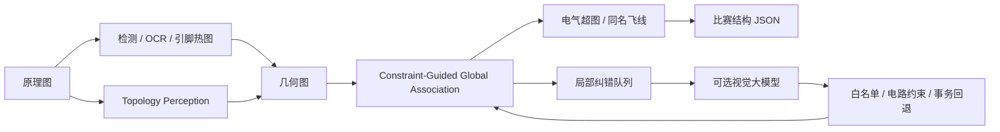

# GraphSchematic 开发实现与复现

当前默认流程为 Geometry-to-Electrical 双图推理。本文是实现记录，正式比赛技术报告按用户要求暂缓。框架能够直接从 PNG/JPG 推理，结果仍需提高元件文本与 IC 引脚识别精度，不能据此宣称已达到比赛提交精度。

## 双图与证据优先级

几何图节点包含 pin endpoint、wire endpoint、junction、label。边只记录图像上的真实 wire；未识别编号的学习引脚候选以 `number_unresolved` 保留，暂不伪造比赛输出中的引脚编号。标签有局部 OCR 时保存对应文字位置，否则标注为符号/标签语义证据。

电气超图以引脚集合为 hyperedge，并记录所属实际导线。相同标签仍合并电气网络，`flying_label_equivalence` 保存逻辑飞线关系，不新增跨图物理导线。比赛 JSON 只含 components、pins、nets；双图和纠错队列保存为独立文件。

Topology > Geometry > Color：Topology Perception 对接触位置给出 connected / disconnected / uncertain。不能确认的接触会阻止仅凭几何邻近合并。颜色只是六通道局部视觉输入之一；导线提取使用灰度，不能以颜色相同决定电气连接。



## Topology Perception

模型由 RGB、灰度、水平与垂直笔画六通道 CNN，以及四方向 arm 几何 MLP 融合。训练使用 977 个裁剪，验证 137 个裁剪，按页面划分且排除近重复验证页 0237。正例来自源数据 divergePoints，负例来自不同源网络内部交叉；这是弱监督，未覆盖所有接触类型。

训练含 60% 灰度增强、旋转、几何分支随机中和。验证 F1=0.9173、precision=0.9385、recall=0.8971（0.5 分类阈值）。验证集用于选择模型和阈值，不是独立测试集。RGB 与灰度验证的 137 个分类结果一致；几何分支中和 F1=0.8873，不能据此推断任意图像上的颜色不变性。

推理连接阈值 0.96；没有充分验证的高精度断开阈值，因此低置信度保持 uncertain。v2 加入中心连通分量的三臂 T 证据及笔画宽度归一化圆点证据，并遮蔽全部检测符号，避免把符号笔画当作导线。圆点证据仍需结合模型概率；三臂证据需要真实像素接触。

## 全局关联与电路约束

每个未接触导线的编号引脚产生最多三个邻近网络候选，以及保持不连接的选择。候选联合考虑距离、沿线像素支持与引脚方向。当前评分是手工加权，图推理采用宽度 16 的 beam search，属于有界近似全局搜索，尚非训练好的 GNN 或精确全局求解器。

新增关联必须通过图像支持、拓扑允许和电路域约束。显式 GND/正电源及不同电压冲突禁止新增合并；非零 R/C/L 两端短接加入软惩罚。多个近优解不一致时保留未决。已经观察到的物理连接不因电路先验而删除，仅报告复核问题。R/C/L/Fuse 的双引脚等先验也用于复核，不伪造引脚。

## 受约束大模型纠错

队列最多八项，含关联与局部 OCR 文本候选。大模型只能 accept/reject 已有候选，或 choose_text 选择已有 OCR 选项；不能生成任意引脚、导线、坐标或元件值。输入观测 SHA256、候选 ID、预算和硬约束均验证，不合法事务回退本地结果。未编号引脚与未决拓扑另外进入复核记录，当前不允许模型直接修改它们。

可选接口使用 HTTPS chat-completion 格式，在环境变量中设置 GRAPHSCH_LLM_ENDPOINT（完整接口 URL）、GRAPHSCH_LLM_MODEL、GRAPHSCH_LLM_API_KEY。未配置时零网络调用。当前未进行真实在线纠错评测，因此没有大模型效果提升结论。

## 整图对照

相同 55 张 PCBnet 开发验证页；0237 因训练页近重复排除。元件和引脚分支固定。结果来自 CVJsonStd 转换的开发代理，`official_equivalence:false`。

| 流程 | Component F1 | Pin F1 | Net F1 | Line F1 | 代理分 |
| --- | ---: | ---: | ---: | ---: | ---: |
| 多源检测与引脚基线 | 0.21582 | 0.09769 | 0.18710 | 0.02246 | 15.6900 |
| 双图关联消融 | 0.21582 | 0.09769 | 0.18710 | 0.02246 | 15.6900 |
| Topology v1 | 0.21582 | 0.09769 | 0.19388 | 0.03282 | 16.0309 |
| Topology v2（默认） | 0.21582 | 0.09769 | 0.19660 | 0.07206 | 16.5184 |

v2 相对基线 28 页改善、9 页退化、18 页不变。仅关联消融未产生整图分数收益，应继续学习候选评分及补全引脚语义。v2 平均约 13.73 秒/页；不同运行存在资源竞争，不能直接以旧运行时间宣称加速。验证页参与架构选择，仍需新图和官方评测确认泛化。

## 复现命令

在项目根目录使用已安装推理依赖的 Python：

```powershell
.venv/Scripts/python.exe -m pcbparse infer data/examples/guide-schematic.png --output output/graphschematic/current.json --observations output/graphschematic/observations.json --graph-output output/graphschematic/dual-graph.json --review-output output/graphschematic/review.json --diagnostics output/graphschematic/diagnostics.json --overlay output/graphschematic/overlay.png
.venv/Scripts/python.exe -m pcbparse batch data/examples --output output/graphschematic/batch
.venv/Scripts/python.exe -m pcbparse infer data/examples/guide-schematic.png --graph-mode legacy --output output/graphschematic/legacy.json
.venv/Scripts/python.exe -m pcbparse graph-build output/graphschematic/observations.json --image data/examples/guide-schematic.png --output output/graphschematic/replay.json --graph-output output/graphschematic/replay-graph.json --review-output output/graphschematic/replay-review.json
.venv/Scripts/python.exe scripts/request_graph_corrections.py --help
.venv/Scripts/python.exe scripts/benchmark.py --limit 0 --pin-model models/pins/pin-heatmap.onnx --text-constraints --graph-mode full --output output/benchmark-graph-reproduction
.venv/Scripts/python.exe scripts/compare_graph_runs.py
.venv/Scripts/python.exe -m unittest discover -s tests -q
.venv/Scripts/python.exe scripts/package_development.py
```

开发 ZIP 包含推理源码、训练脚本、测试、模型及执行记录，不包含原始训练数据。Dockerfile 已接入拓扑权重，但本机未安装 Docker，尚未验证镜像构建；正式报告与官方运行环境验证仍待完成。


## 2026-10-04 拓扑保持引脚共识

新增 `pcbparse/pin_consensus.py`：两个定位模型只对同名同编号、距离 ≤6 px 的端点提出均值，并用几何图分区和最终网络/导线签名约束接受。复用融合前已确认的关联，不在融合步骤提出新的网络连接。不是训练式 GNN，也没有置信度校准。默认配置保留原主模型，官方适配模型作为辅助；可用 `--pin-ensemble none` 消融。55 页回放只有很小平均增益，1 例退步；10GT 端到端代理分为 18.4532。完整记录见 [项目进度报告](PROJECT_PROGRESS_2026-10-04.md) 与 `output/ablation/pin-consensus.json`。
